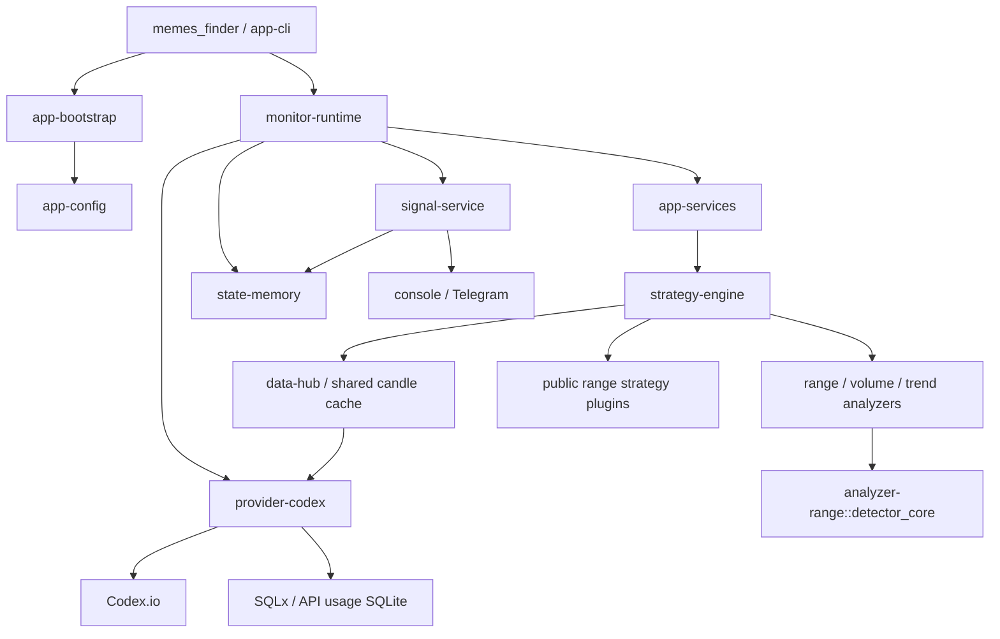

# MEMSI architecture

This workspace builds one executable: `memes_finder`. Workspace crates are libraries used by that target. There is no secondary monitor executable, HTTP server, wallet tracker, portfolio ledger, transaction executor, replay tool, or standalone range CLI.

## Module boundaries

| Layer | Libraries | Responsibility |
|---|---|---|
| Shared values | `domain` | Validated chain, token, pool, candle, metric, timestamp, hash, and market-evidence types |
| Plugin contracts | `plugin-api`, `analysis-api`, `strategy-api` | Metadata and traits for compile-time plugins |
| Provider contracts | `provider-api`, `discovery-api` | Requests, cancellation, deadlines, discovery filters and transport observations |
| Market data | `provider-codex`, `data-hub` | Codex GraphQL, quota enforcement, bounded HTTP admission, candle cache and singleflight |
| Computation | `analyzer-range`, `analyzer-volume`, `analyzer-trend` | Deterministic calculations from validated inputs |
| Strategies | `strategy-range`, `strategy-low-risk`, `strategy-high-risk` | Public profile wrappers, screening, pump signals and range decisions |
| Orchestration | `app-services`, `strategy-engine`, `monitor-runtime` | Input planning, shared computation, independent evaluation, discovery cycles and watchlist TTL |
| Notifications | `signal-api`, `signal-service`, `notification-api`, `notification-render`, `notification-console`, `notification-telegram` | Signals, idempotent acceptance, delivery and presentation |
| Process state | `state-api`, `state-memory` | Signal/dedupe/outbox state and watchlist checkpoints; no accounting or execution repositories |
| Construction and CLI | `app-config`, `app-bootstrap`, `app-cli`, `app-api` | Configuration, factories, commands and the CLI's public JSON shapes |

The horizontal RangeDetector is embedded in `analyzer-range/src/detector_core/`. Its algorithm is preserved, but it has no separate package, executable, or root directory.

`domain` carries data between layers; it does not fetch or persist it. Traits live in the corresponding API libraries, implementations in adapters, and application construction in bootstrap. Strategies consume validated shared inputs rather than issuing independent HTTP requests. A rejection by one strategy does not cancel another strategy's match.

## Data flow and persistence

Discovery gets ranked candidates from Codex, screens metrics, and sends qualifying candidates to evaluation. DataHub shares candle requests between consumers. The engine executes bound analyzers and strategies. Accepted matches enter the in-memory signal/outbox store; delivery leases and stable identities suppress duplicate local acceptance. Watch records absent from discovery expire according to the program-level TTL.

Candles, watchlist, accepted signals and delivery state are in RAM. SQLite is used only by the Codex per-key quota ledger through SQLx. No wallet, position, portfolio, ledger, execution, USD depth-valuation, or optional durable signal-state backend is included. The monitor does not keep a decision journal.

## Execution model and technologies

The monitor uses one Tokio executor thread. Candidate futures, bounded HTTP requests, shared cache flights, and analysis/delivery loops overlap I/O. Analyzer and strategy calculations are synchronous on that thread. SQLx moves SQLite work to its connection worker; async does not make CPU calculations parallel.

The project uses Rust 2024 / Rust 1.94+, Cargo workspaces, Tokio, futures, Serde/TOML/JSON, clap, reqwest with Rustls, SQLx SQLite and SHA-256 identities. The architecture is a modular monolith with ports/adapters, a composition root, compile-time strategy plugins, singleflight caching, an in-memory transactional outbox and bounded supervision.

See [README.md](../README.md) for usage and configuration, [CONTENTS.md](CONTENTS.md) for the package inventory.
